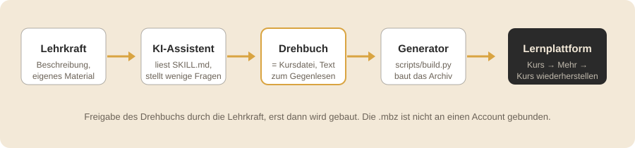
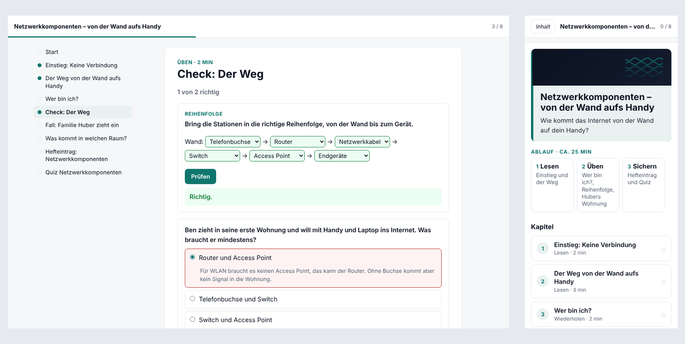

# Kursmühle – für die ByCS-Lernplattform

   

**Version 1.0.3** (Stand 23.10.2026) · [Projektseite](https://kursmuehle.de/) ·
[Skill-Zip herunterladen](https://github.com/simon-sarkar/kursmuehle/releases/latest/download/kursmuehle.zip) ·
[`ROADMAP.md`](ROADMAP.md) · [`CHANGELOG.md`](CHANGELOG.md)

**Ein KI-Assistent baut aus einer Beschreibung oder eigenem Unterrichtsmaterial eine importierbare Kurssicherung (`.mbz`) für die ByCS-Lernplattform.**

## Wozu Kursmühle dient

Einen Kurs in der [ByCS-Lernplattform](https://www.bycs.de/) (Bayern, Moodle-basiert,
früher mebis) von Hand anzulegen heißt, jede Seite und jede Übung einzeln anzulegen und
zu befüllen. Mit diesem Skill beschreibst du den Kurs oder gibst vorhandenes Material ab,
und der KI-Assistent liefert eine Kurssicherung zum Import.

- Ausgangsmaterial kann eine Beschreibung sein oder eigene Unterlagen: Folien,
  Arbeitsblätter, Notizen, Fotos von eigenem Material.
- Vor dem Bau bekommst du ein kurzes Drehbuch zum Gegenlesen. Darin ist
  markiert, was aus deinem Material stammt und was die KI ergänzt hat.
- Ein Kurs lässt sich in Etappen liefern, das Design nachträglich wechseln und
  die nächste Einheit mit demselben Ablauf bauen.

## Drei Wege

- **Lehrkräfte mit ByLKI oder AIS-Chat:** Diese Angebote führen keinen Code aus. Für sie kommt mit Version 2.0 eine
  Fassung im Browser, die aus dem Drehbuch die Sicherung baut (`ROADMAP.md`). Bis dahin, noch nicht getestet:
  `SKILL.md`, `references/intake.md` und `references/kursdatei.md` aus dem Skill-Zip als Text in den Chat einfügen und
  das Drehbuch schreiben lassen; den Bau übernimmt dann ein Assistent mit Code-Ausführung oder ab 2.0 die Browser-Fassung.
- **Lehrkräfte mit ChatGPT oder Claude:** das [Skill-Zip](https://github.com/simon-sarkar/kursmuehle/releases/latest/download/kursmuehle.zip)
  herunterladen und dem Assistenten geben.
  - ChatGPT: ZIP hochladen und schreiben: „Entpacke das und lies SKILL.md.“ Dahinter den Kurswunsch, zum Beispiel
    „Mach mir eine Einheit zu Bruchrechnen für Jgst 6, 45 Minuten, Selbstlernkurs. Zeig mir zuerst das Drehbuch.“
    Die Code-Ausführung gehört je nach Version als „Datenanalyse“ zum Standardmodell. Den Aufwand auf „Extra High“
    stellen (gibt es auch im Gratiskonto); mit mittlerem Aufwand wurde der Kurs im Test deutlich dünner, ohne Grafiken
    und mit falschem Halt vor dem Bau.
  - Claude: ZIP hochladen und denselben Satz schreiben, oder das ZIP in den Einstellungen als Skill anlegen; dann genügt
    der Kurswunsch. Die Code-Ausführung steht je nach Version in den Einstellungen unter „Dateien erstellen und
    analysieren“ und muss eingeschaltet sein.
  - Danach: Drehbuch lesen, „passt“ sagen, `.mbz` herunterladen, [wiederherstellen](#wiederherstellen).
  - Keine Schülerdaten, keine Namen oder Fotos von Personen ins Material; ob private KI-Konten dienstlich genutzt
    werden dürfen, regeln Schule und Sachaufwandsträger.
- **Nutzer mit einem Agenten wie Claude Code oder Codex:** Repo klonen, dem Agenten `docs/fortgeschrittene.md` geben.
  Dort steht, wie eigene Kurssicherungen als Vorlage dienen, wie eigene Designvorlagen, Textbausteine und Fachregeln
  entstehen und wie das Skill-Zip neu gepackt wird: [`docs/fortgeschrittene.md`](docs/fortgeschrittene.md). Dieser Weg
  braucht auf dem eigenen Rechner Python 3.11+, PyYAML und Pillow.

Für ChatGPT und Claude wird auf dem eigenen Rechner nichts installiert. Die erste Frage des Assistenten lautet „Womit
starten wir?“ mit fünf Wegen (nur ein Thema, eigenes Material, Material und Fragen, Fragen ohne Material, bestehenden
Kurs erweitern); danach höchstens eine Fragerunde, jede Frage mit Vorschlag. Wer nur ein Thema nennt, bekommt keine
Rückfrage; die Annahmen stehen oben im Drehbuch. Nennt der erste Satz Thema, Jahrgangsstufe, Einsatz und Minuten,
entfällt auch die Einstiegsfrage, und der Assistent baut sofort; mit „Zeig mir zuerst das Drehbuch.“ baut er erst nach
der Freigabe.

Wie viel du vorgeben musst, hängt vom Modell ab. Ein starkes Modell mit hohem Aufwand baut aus einem Satz einen
brauchbaren Kurs. Ein kostenloses oder kleines Modell braucht deine Vorgaben: Phasen (Einstieg, Erarbeitung, Übung,
Sicherung), welche Übungstypen und Formate du willst, wie lang die Lesetexte sein sollen, welche Beispiele und welche
Fehlvorstellungen vorkommen. Je genauer die Beschreibung, desto weniger hängt das Ergebnis vom Modell ab; mit „Vorschläge
freigeben“ siehst du das Drehbuch, bevor gebaut wird.

## Wiederherstellen

So sieht der Import auf der ByCS-Lernplattform aus, Schritt für Schritt. Beim ersten Mal in einen Testkurs.

1. **Kurs öffnen → Mehr → Kurs wiederherstellen.** Die `.mbz` in das Feld „Datei“ ziehen oder hochladen, dann
   *Wiederherstellen*.
2. **Schritt „Bestätigen“:** nur *Weiter*.
3. **Schritt „Ziel“:** eine von drei Varianten.
   - *Als neuen Kurs wiederherstellen* in eine Kategorie: der Kurs entsteht neu.
   - *In diesen Kurs wiederherstellen* mit **löschen und dann wiederherstellen**: der Zielkurs wird geleert und neu
     gefüllt. Nur so kommt ein anderes Kursformat (etwa Kacheln) mit.
   - *In diesen Kurs wiederherstellen* mit **zusammenführen**: für Delta-Sicherungen, die neue Abschnitte hinten anhängen.
4. **Schritt „Einstellungen“:** *Weiter*.
5. **Schritt „Schema“:** bei einem Formatwechsel *Kurseinstellungen überschreiben: Ja*, sonst behält der Kurs sein
   bisheriges Kursformat. *Weiter*.
6. **Wiederherstellen.**
7. **Danach:** Hat der Kurs ein Glossar mit Einträgen: Glossar → Mehr → *Einträge importieren* → die mitgelieferte Datei
   `…_glossar.xml`. Badge aktivieren (Mehr → Badges). Kursbild prüfen. Probedurchlauf als Schüler/in.

Eine Sicherung darf höchstens 500 MB haben; `scripts/check.py` warnt ab 400 MB. Wenn etwas nicht passt, reicht ein
Screenshot an den Assistenten; er ändert die Inhalte und baut die Sicherung neu. Übungs-Textfelder nie im Editor der
Plattform speichern (siehe [Vorbehalte beim Textfeld](#vorbehalte-beim-textfeld)).

## Begriffe

| Begriff | Bedeutung |
|---|---|
| Drehbuch, Kursdatei | Der ganze Kurs als kurzer Text (`kurs.md`), den die Lehrkraft gegenliest und aus dem der Generator die Sicherung baut. |
| Steckbrief | Kurze Datei (`steckbrief.yaml`) mit den Rahmendaten des Kurses, etwa Jahrgangsstufe, Kursformat und Designvorlage. |
| Delta-Sicherung | Sicherung nur mit neuen Abschnitten, die per *Zusammenführen* hinten an einen laufenden Kurs angehängt wird. |
| Textfeld-Modus | Übungen stehen als Block direkt in einem Textfeld auf der Kursseite statt als eigene Aktivität. |
| Website-Modus | Ein Abschnitt wird eine HTML-Seite mit Kapiteln und Übungen, die im Kurs eingebettet oder als eigenes Fenster erscheint. |
| Skill-Zip | Die Datei `kursmuehle.zip` mit Anleitung, Generator und Beispielen, die man dem Assistenten gibt. |
| Tokens | Die Einheit, in der KI-Anbieter Textmenge abrechnen und begrenzen; 90 KB Text sind grob 25 000 Tokens. |
| Sonnet-Klasse | Die mittlere, günstigere Modellstufe von Anthropic (Claude Sonnet); der Skill soll ohne das teuerste Modell auskommen. |

> **Projektstatus: Version 1.0.3 = Alpha.** 1.x ist der Skill für KI-Assistenten mit Code-Ausführung (Alpha), 2.x die
> Browser-Fassung für alle Chats (Beta, im Bau), 3.0 die vollständige Fassung.
> Mit 1.0 getestet in Claude Code (Agent mit Dateizugriff), im Fremdtest mit einem frischen Assistenten der
> Sonnet-Klasse, der nur das Skill-Zip und einen Satz bekam. Am 23.10.2026 entstand in ChatGPT mit einem kostenlosen
> Konto in zwei Durchläufen je ein Kurs zum Satz des Pythagoras ([Richtwerte](#richtwerte)); Kurs B wurde am 23.10.2026 auf der Plattform importiert und läuft.
> Durchläufe in claude.ai stehen aus.
> Import getestet 23.10.2026, siehe [Protokoll](docs/entwicklung/protokolle/import-tests-2-5.md): Themen- und
> Kachelformat mit Kachelbildern, alle acht Moodle-Module, Glossar-XML, Website-Modus (eingebettet) und Textfeld-Modus mit
> mehreren Blöcken; Delta-Sicherungen seit 0.1. Nicht per Import geprüft sind die Formate Wochen, Ein-Themen, Komprimiert
> und Einzelaktivität; sie beim ersten Einsatz in einen Testkurs importieren. Kein offizielles Produkt der Plattform;
> wenn sich die Lernplattform ändert, wird der Skill angepasst.

## Systemübersicht



- Die KI schreibt nur die Inhalte. Das Archiv aus über hundert verknüpften
  XML-Dateien, Hashes und IDs baut der Generator.
- Das Drehbuch enthält den gesamten Kurs als kurzen Text mit Zeitschätzung
  je Element und Quellenmarkierung (aus dem Material / von der KI ergänzt).
  Dieselbe Datei ist die Kursdatei: Der Generator liest sie direkt, nichts
  wird nach der Freigabe noch einmal abgetippt. Nachdem der Assistent das
  Drehbuch geschrieben hat und bevor die Lehrkraft es sieht, ist er angewiesen,
  es gegen zehn didaktische Standardannahmen und eine Markerliste mit Proben zu
  prüfen (`references/intake.md` §3, `references/qualitaet.md`); im Fremdtest
  blieb dabei je Durchlauf ein Marker übrig. Zweck und Quelle je Element stehen
  nur im Drehbuch.
- Die Sicherung ist nicht an ein Konto gebunden; in den Tests ließ sie sich ohne
  Vorarbeit in Kurse eines anderen Kontos einspielen. Vor der Lieferung prüft
  `scripts/check.py` jede Sicherung auf Struktur, Dateien, IDs und H5P-Versionen.

## Was Kursmühle kann

### Drei Darstellungswege für Übungen

- **Übung im Textfeld:** Quiz, Zuordnen, Lernkarten, Lückentext und Geschichte stehen als Block direkt zwischen den
  Lesetexten auf der Kursseite, ohne Nachladen und ohne Bewertung (`website: textfeld`).
- **Einheit als Website-Datei:** Ein Abschnitt wird eine HTML-Seite mit Startseite, Kapitelnavigation, Fortschritt und
  Übungen, eingebettet, im Vollbild oder in einem neuen Fenster (`website: ja`).
- **H5P- und Moodle-Aktivitäten für Bewertung und Abschluss:** Was eine Bestehensgrenze hat, für ein Badge zählt oder
  abgegeben wird, bleibt eine Aktivität der Plattform und erscheint im Abschlussstatus oder im Bewertungsbuch.

#### Vorbehalte beim Textfeld

- **Übungs-Textfelder nicht im Editor öffnen.** Bearbeitet eine Lehrkraft ein Textfeld mit Übungsblock über
  „Einstellungen bearbeiten“ und speichert, entfernt der Editor der Plattform Skript und Stil; die Übung ist danach ein
  totes Gerüst. Änderungen laufen über das Drehbuch und ein Delta oder einen Neuimport. Ungeprüfter Ausweg: den
  Texteditor in den Nutzereinstellungen vorübergehend auf „Textbereich“ stellen, dann bearbeiten.
- Die Moodle-App führt JavaScript im Textfeld möglicherweise nicht aus; die Übung zeigt dann den Hinweis, die Kursseite
  im Browser zu öffnen.
- Große Inline-Blöcke blähen die Kursseite; jeder Block bringt etwa 10 KB Stil und Skript mit.
- Die Nutzungsbedingungen der Plattform erlauben Lehrkräften Beiträge mit JavaScript (4.1.3), und die Probe vom
  23.10.2026 zeigt, dass Skripte im Textfeld laufen (`tools/jsprobe`).

### Sechs Kursformate

| Format | Was die Lernenden sehen |
|---|---|
| Themen | Alle Abschnitte untereinander auf einer Seite. |
| Kacheln | Jeder Abschnitt ist eine Kachel mit eigenem textfreiem Kachelbild oder Icon und Fortschrittsanzeige; ein Überblick in Allgemeines entfällt, weil er die Kacheln doppelt. |
| Wochen | Die Abschnitte tragen Datumsbereiche ab dem Kursbeginn aus dem Steckbrief. |
| Ein-Themen | Die Abschnitte erscheinen als Reiter, sichtbar ist immer einer. |
| Komprimiert | Die Abschnitte lassen sich auf- und zuklappen. |
| Einzelaktivität | Der Kurs besteht aus genau einer Aktivität, etwa einem Test oder einem Forum. |

### Elementtypen

| Element | Was es ist |
|---|---|
| Banner | Bild, Titel und ein Satz als erstes Element des Kurses. |
| Textfeld | Kurzer formatierter Text direkt auf der Kursseite. |
| Seite | Längerer Lesetext mit Bildern auf einer eigenen Seite. |
| Überblick | Kopfkarte einer Einheit mit Dauer und Ablauf. |
| Link, Video | Verweis auf eine Webseite; YouTube und Vimeo werden eingebettet. |
| Lesebuch | H5P-Buch mit mehreren Seiten und eingebauten Kontrollfragen. |
| Quiz | H5P-Fragenset mit Multiple Choice, Richtig/Falsch, Einsetzen, Markieren und Lückentext. |
| Zuordnen | Elemente werden in Kategorien sortiert. |
| Lernkarten | Karten mit Vorder- und Rückseite, auf Wunsch mit Bild. |
| Geschichte | Szenen und Entscheidungen mit mehreren Enden. |
| Lückentext | Text mit Eingabelücken, Alternativen und Tipps. |
| Umfrage | Selbsteinschätzung auf einer Skala (Moodle-Feedback). |
| Badge | Abzeichen, das nach dem Abschluss festgelegter Elemente verliehen wird. |
| Unterabschnitt | Gruppe von Elementen innerhalb eines Abschnitts. |
| Test | Moodle-Test mit Fragensammlung, Versuchen und Eintrag im Bewertungsbuch. |
| Aufgabe | Abgabe als Text oder Datei mit Bewertung und Fälligkeit. |
| Datei | Eine Datei der Lehrkraft, etwa ein Arbeitsblatt als PDF. |
| Verzeichnis | Mehrere Dateien in einem Ordner. |
| Forum | Austausch oder Fragen und Antworten. |
| Buch | Moodle-Buch mit Kapiteln und Unterkapiteln für längere Lesetexte. |
| Abstimmung | Meinungsbild mit einer oder mehreren Antworten. |
| Glossar | Begriffe mit Erklärungen und Aliassen. |

### Weiteres

- **Designvorlagen:** Drei Vorlagen (schlicht, kacheln, magazin) färben alle Textbausteine ein, gewählt im Steckbrief.
- **Glossar-Import:** Die Einträge eines Glossars liegen als XML-Datei neben der Sicherung und kommen über
  *Einträge importieren* in den Kurs.
- **Delta-Sicherungen:** Neue Abschnitte kommen als eigene Sicherung per *Zusammenführen* in einen laufenden Kurs, der
  Lernfortschritt bleibt erhalten.
- **Prüfdurchlauf:** Nachdem der Assistent das Drehbuch geschrieben hat und bevor die Lehrkraft es sieht, ist er
  angewiesen, es gegen die Standardannahmen D1–D10 und eine Markerliste mit Proben zu prüfen und Treffer zu beheben.
- **Steuerungsgrad:** Die Lehrkraft entscheidet selbst, gibt Vorschläge frei oder lässt die KI alles machen.

## Was der Generator kann – und was (noch) nicht

| Kann | Noch nicht |
|---|---|
| Kursformate Themen, Kacheln (mit Kachelbild oder Icon je Abschnitt), Wochen, Ein-Themen, Komprimierte Abschnitte, Einzelaktivität; beliebig viele Abschnitte und Unterabschnitte | Lernlandkarte, Mimo (kein Grid auf der Plattform) |
| Textfelder und Seiten mit Textbausteinen (Überschrift, Schritte, Tabellen, Kästen, Merke, Bild mit Unterschrift) in drei Designvorlagen (schlicht, kacheln, magazin), wählbar im Steckbrief | Lektion, Wiki, Datenbank, Chat, Workshop, externes Tool |
| Moodle-Module: Test (Multiple Choice, Wahr/Falsch, Kurzantwort; Fragen in der Fragensammlung), Aufgabe (Text- und Dateiabgabe), Datei, Verzeichnis, Forum, Buch mit Kapiteln, Abstimmung, Glossar | Weitere Fragetypen im Test (Zuordnung, Lückentext, numerisch), Zeitlimits, Forum-Diskussionen |
| H5P: Interactive Book, Branching Scenario, Question Set, Drag and Drop, Fill in the Blanks, Dialog Cards, Course Presentation (nur als Szene einer Geschichte, nicht einzeln wählbar); Bausteine Text, Bild, Multiple Choice, True/False, Drag the Words, Mark the Words, Summary, Single Choice Set | Weitere H5P-Typen (Interactive Video, Image Hotspots, Memory …) |
| Feedback-Umfragen, Links/Videos (eingebettet), Badges, Kursbild, Abschlussverfolgung | Gruppen, Termine, Kursabschluss-Kriterien |
| Kursbanner als erstes Element (Bild, Titel, ein Satz); Bild von der KI erzeugt, gerendert (`scripts/banner.py`) oder von der Lehrkraft nach Prompt; Kursbild und Kachelbilder textfrei (`banner.py --kachel`: eigenes Motiv je Abschnitt) | Abschnitts- und Kachelbilder automatisch aus dem Material |
| Website-Modus: ein Abschnitt als eine HTML-Seite (eingebettet, Vollbild oder neues Fenster) mit Startseite, Kapitelnavigation, Fortschritt und Übungen mit Rückmeldung (Quiz, Zuordnen, Lückentext, Markieren, Lernkarten, Geschichte); dieselbe Kursdatei, `build.py --website` | Bewertung und Abschluss je Übung in der Website, eigene Spiele und Simulationen als Vorlage |
| Textfeld-Modus: formative Übungen (Quiz, Zuordnen, Lernkarten, Lückentext, Geschichte) als Block im Textfeld zwischen Lesetexten, ohne iframe, mehrere Blöcke je Kursseite; Abschlussrelevantes bleibt Aktivität; `website: textfeld` | Ausführung in der Moodle-App |
| Zugriffsbeschränkung „sichtbar ab Datum“; Nachlieferung per Delta-Sicherung | Andere Zugriffsbedingungen (Abschluss von X, Bewertung, Gruppe) |
| Prüfdurchlauf vor der Freigabe: Standardannahmen D1–D10, Markerliste mit Proben, Fachprüfung gegen das Bezugselement; Drehbuch-Zeilen `Abweichung:` und `Offen:` und der Marker `[Zweck: …]` gelangen nie in den Kurs | Automatische Warnung des Parsers bei mechanisch erkennbaren Markern (Ausrufezeichen, Emojis, Genderzeichen) |

## Repository-Struktur

```
SKILL.md       Einstieg für den KI-Agenten: Ablauf, Wiederherstellungsanleitung, harte Regeln, Grenzen
references/    spec.md (Sicherungsformat, Plattformwerte, H5P-Strukturen),
               kursdatei.md (Format der Kursdatei kurs.md), formate.md (Kursformate),
               h5p-vorlagen.md (json_content aller Typen, deutsche UI-Texte),
               skelette.md (XML-Skelette), intake.md (Fragerunden, Darstellungsweg,
               Standardannahmen D1–D10, Drehbuch, Steckbrief), qualitaet.md (Prüfdurchlauf)
scripts/       Generator (gen/), build.py, check.py (Sicherung prüfen), package.py (Skill-Zip), Vorlagen, tests/
examples/      netzwerk9/  – eine Einheit, 25 min: Vorbild für neue Kurse
               alltagskompetenz/ – großer Kurs mit Unterabschnitten, Badge, Delta
               module/ – ein Abschnitt mit Test, Aufgabe, Datei, Verzeichnis, Forum, Buch, Abstimmung, Glossar
               (je kurs.md, assets/, steckbrief.yaml)
docs/          Projektseite (index.html), Logo und Badges, fortgeschrittene.md (Repo und Agent), erfahrungen.md,
               entwicklung/ (Arbeitspakete AP1–AP9, Protokolle der Tests)
tools/h5ptest/ Render-Test der H5P-Inhalte außerhalb der Plattform (h5p-standalone + Playwright)
tools/jsprobe/ Fünf-Minuten-Test: läuft JavaScript im Textfeld und in einer eingebetteten Website? (Ergebnis im README dort)
AGENTS.md      Arbeitsregeln für Agenten, die am Repo arbeiten (CLAUDE.md verweist darauf)
CHANGELOG.md   Versionen und bekannte Lücken
```

## Richtwerte

Aus dem Fremdtest zu 1.0 (`docs/entwicklung/protokolle/AP9_fremdtest.md`): ein frischer Assistent der Sonnet-Klasse bekam
nur das Skill-Zip und den Satz „Mach mir eine Einheit zu Bruchrechnen für Jgst 6, 45 Minuten, Selbstlernkurs.“

| Größe | Durchlauf 1 | Durchlauf 2 |
|---|---|---|
| Bis zur fertigen `.mbz` mit Protokoll | 5 min 10 s | 5 min 46 s (erste `.mbz` nach etwa 3 min) |
| Tokens gesamt (Agent-Schnittstelle) | 138 000 | 154 000 |
| Rückfragen, die der Assistent gestellt hätte | 2 | 0 |
| Nachrichten an die Lehrkraft (Schätzung, ohne Lesezeit der Lehrkraft) | 2 | 1 |
| Bauläufe bis `check.py` OK | 1 | 1 |

Der Fremdtest lief in Claude Code (Agent mit Dateizugriff), nicht über den Upload in ChatGPT oder claude.ai. Mit
Version 0.1 lag ein kompletter Kurs mit mehreren Abschnitten und vom Assistenten erzeugten Bildern in ChatGPT bei etwa
sieben Minuten (Einzelbeobachtung, nicht protokolliert).

ChatGPT mit kostenlosem Konto, 23.10.2026 (`docs/entwicklung/protokolle/chatgpt-free.md`): Eingaben „Entpacke das und lies
SKILL.md“, „Starte den Skill“, dann Weg „Fragen“, Steuerungsgrad c und „Mathematik Satz des Pythagoras, 9. Klasse
Mittelschule, Selbstlernkurs ca. 45 min, eine Einheit“.

| Größe | A: GPT-5.6 Terra, Aufwand Medium | B: GPT-6 Luna, Aufwand Extra High |
|---|---|---|
| Dauer | 9 min (22:05–22:14), davon 4 min Halt mit der falschen Meldung, es gebe keine lauffähige Python-Umgebung | 4 min (22:21–22:25), ohne Halt |
| Bilder | keine | drei selbst gezeichnete: beschriftetes Dreieck, Banner, Badge |
| Lesetext | drei kurze Lesetexte | rund 900 Wörter mit durchgerechneten Beispielen |
| Übungen | zwei Übungsblöcke | zwei Übungsblöcke |
| Abschluss | Abschlusstest | H5P-Abschlusstest mit zehn Fragen, davon acht Fälle |

Kurs B wurde am 23.10.2026 auf der Plattform importiert und läuft. Durchläufe in claude.ai und mit ByLKI stehen aus; die
Protokollvorlagen liegen in `docs/entwicklung/protokolle/`.


## Ohne KI bauen (für Entwickler)

Beispielkurs direkt aus dem Generator (Python 3.11+, PyYAML, Pillow):

```bash
python3 scripts/build.py --content examples/netzwerk9
```

Der Kursinhalt steht in `examples/netzwerk9/kurs.md` (Format: `references/kursdatei.md`);
die Bilder in `examples/netzwerk9/assets` sind einfache, selbst erzeugte Schemazeichnungen. `build.py` prüft
die fertige Sicherung am Ende mit `scripts/check.py` (auch einzeln: `python3 scripts/check.py <datei.mbz>`, Ausgabe `OK` oder `FEHLER`-Zeilen).
`python3 scripts/tests/test_kursdatei.py` prüft Parser und Beispiele, `scripts/tests/test_check.py` das Prüfskript,
`scripts/tests/mbz_diff.py` vergleicht zwei Sicherungen ohne IDs und Zeitstempel, `scripts/tests/render_vorlagen.py`
rendert die Kursseite je Designvorlage bei 390 und 1200 px (Playwright; `--vorlage` an `build.py` wählt die Vorlage),
`scripts/tests/test_website.py` baut netzwerk9 und alltagskompetenz als Website und im Textfeld-Modus und klickt
Navigation, Übungen und mehrere Blöcke auf einer Seite bei 390 und 1280 px durch.

Website-Variante des Beispiels (eine HTML-Seite statt zehn Aktivitäten; Vorschau `…_website.html` neben der `.mbz`):

```bash
python3 scripts/build.py --content examples/netzwerk9 --website
```

Übungen als Blöcke im Textfeld (Vorschau aller Blöcke `…_textfeld.html` neben der `.mbz`):

```bash
python3 scripts/build.py --content examples/netzwerk9 --website textfeld
```



## Kurs in Etappen

Zwei Wege:

- **Fertig bauen, wochenweise freigeben:** im Steckbrief steht je Lerneinheit
  ein Datum „sichtbar ab“; alles wird einmal importiert.
- **Nach und nach bauen:** je Etappe liefert die KI eine Delta-Sicherung nur
  mit den neuen Abschnitten, eingespielt über *In diesen Kurs zusammenführen*.
  Bestehende Abschnitte und der Lernfortschritt bleiben erhalten.

Bereits importierte Abschnitte lassen sich per Sicherung nicht nachträglich
ändern. Wer etwas korrigieren will, löscht den Abschnitt und spielt die
Delta-Sicherung neu ein; der Lernfortschritt in diesem Abschnitt geht dabei
verloren.

## Status / Roadmap

- [x] Generator für Sicherungen (Moodle 5.2, mod_hvp), Import getestet 23.10.2026, siehe [Protokoll](docs/entwicklung/protokolle/import-tests-2-5.md)
- [x] H5P-Render-Test und inhaltliche Gegenprüfung durch zweiten Agenten
- [x] Delta-Sicherung („Zusammenführen“) und „sichtbar ab Datum“
- [x] Fragerunde (Intake) mit Steuerungsgrad, Drehbuch-Format, Zeitcheck, Änderungsliste
- [x] Drehbuch-Parser: Das Drehbuch ist die Kursdatei (`kurs.md`), der Generator liest sie direkt
- [x] Prüfskript `check.py`: jede Sicherung wird vor dem Import auf Struktur, Dateien und H5P-Versionen geprüft
- [x] Menüführung: „Womit starten wir?“ – Thema, altes Material, Material + Fragen, Fragen-Intake
- [x] Schlanke Designvorlagen zur Auswahl; Kursbanner, generiert vom Assistenten, wenn er es kann
- [x] HTML-Formatierung für Lesetexte: Überschriften, Listen, Merk- und Beispielkästen statt Fließtext
- [x] Modultypen für 1.0: Test, Aufgabe, Datei, Verzeichnis, Forum, Buch, Abstimmung, Glossar (alle acht importiert)
- [x] Kursformate Kacheln (Kachelbild/-icon je Abschnitt, importiert), Wochen, Ein-Themen, Komprimiert, Einzelaktivität
- [x] One-Page-Darstellung ohne Ladezeiten: Übungen im Textfeld (seit 0.9.1, importiert), Einheit als Website-Datei (seit 0.8)
- [x] Fremdtest mit frischem Assistenten der Sonnet-Klasse, Skill-Zip, Projektseite (1.0)
- [ ] 1.1: Steckbrief und Designvorlage aus einer eigenen Sicherung ableiten (`vorlage_aus_sicherung.py`), Übungsblöcke, die
      ohne Skript als Tabelle oder Fragenliste lesbar bleiben, Website als SCORM-Paket für Bewertung und Abschluss
- [ ] Abschnitts- und Kachelbilder aus dem Material; eigene Spiele und Simulationen als Vorlagen im Website-Modus
- [ ] 2.0: Kursmühle im Browser, damit auch Chats ohne Code-Ausführung (ByLKI, AIS-Chat) bauen können

Reihenfolge und Details in [`ROADMAP.md`](ROADMAP.md).

## Rückmeldung geben

Ich freue mich über Rückmeldungen: Hilft Kursmühle im Unterrichtsalltag, was fehlt, wo hat es gehakt? Schreib mir an
kursmuehle@pm.me, ein GitHub-Konto ist dafür nicht nötig; wer am Code mitarbeitet, kann zusätzlich ein
[Issue](https://github.com/simon-sarkar/kursmuehle/issues) anlegen. Am meisten hilft mir, wenn Fach, Jahrgangsstufe,
Assistent und Dauer dabeistehen. Gesammelte Rückmeldungen und gebaute Kurse stehen in
[`docs/erfahrungen.md`](docs/erfahrungen.md).

## Mitmachen

Fehlerberichte und Erweiterungen als Issue oder Pull Request; eigene Vorlagen, Bausteine und Fachregeln beschreibt
[`docs/fortgeschrittene.md`](docs/fortgeschrittene.md). Am meisten hilft
ein Hinweis, welches Kursformat oder welche Aktivität fehlt; Kurssicherungen
selbst gehören nicht ins Repo (die Nutzungsbedingungen der Plattform untersagen
die Weitergabe von Dateien an Dritte) – veröffentlicht werden nur die daraus
abgeleiteten Schemata mit Platzhaltern. Beispielkurse in `examples/` enthalten
nur eigene Texte und selbst erzeugte oder CC0-Bilder: keine Schulbuchseiten,
fremden Fotos oder Logos, keine Namen echter Personen oder Schulen.

Wer einen Pull Request einreicht, stellt seinen Beitrag unter die Lizenzen
dieses Repositories und ist damit einverstanden, dass der Autor spätere
Versionen unter anderen Bedingungen veröffentlichen kann.

## Lizenz

Nicht kommerziell. Schulen, Lehrkräfte und Fortbildungen dürfen den Skill
nutzen, verändern und weitergeben; der Einbau in kommerzielle Produkte oder
Dienste ist nicht erlaubt.

- **Code** (`scripts/`): [PolyForm Noncommercial 1.0.0](LICENSE)
- **Texte, Vorlagen, Beispielkurse** (alles andere):
  [CC BY-NC-SA 4.0](LICENSE-DOCS.md) – Namensnennung, nicht kommerziell,
  Weitergabe unter gleichen Bedingungen

Mit dem Skill erzeugte Kurse gehören der Lehrkraft, die sie gebaut hat.
Spätere Versionen können unter anderen Bedingungen erscheinen; einmal
veröffentlichte Fassungen bleiben unter ihrer Lizenz nutzbar.

## Danksagung

- [Moodle](https://moodle.org/): quelloffener Backup-Code, an dem sich das Sicherungsformat ablesen lässt
- [H5P](https://h5p.org/) und das Plugin [mod_hvp](https://github.com/h5p/moodle-mod_hvp):
  interaktive Inhalte als JSON
- [h5p-standalone](https://github.com/tunapanda/h5p-standalone): Render-Test
  der H5P-Inhalte außerhalb der Plattform
- [Claude Code](https://claude.com/claude-code) (Anthropic): Generator,
  Spezifikation, Beispielkurse und Dokumentation wurden damit entwickelt

## Haftungsausschluss

Keine Verbindung zum Betreiber der Lernplattform. Sicherungen vor dem Einsatz
immer in einem Testkurs importieren und prüfen. Das Drehbuch ist die
Kontrollinstanz für Inhalte, die die KI ergänzt hat; die fachliche
Verantwortung bleibt bei der Lehrkraft.

---

**Für den KI-Agenten:** [`SKILL.md`](SKILL.md) laden; Referenzen in
`references/`, Generator in `scripts/`, Beispielkurse in `examples/`.
